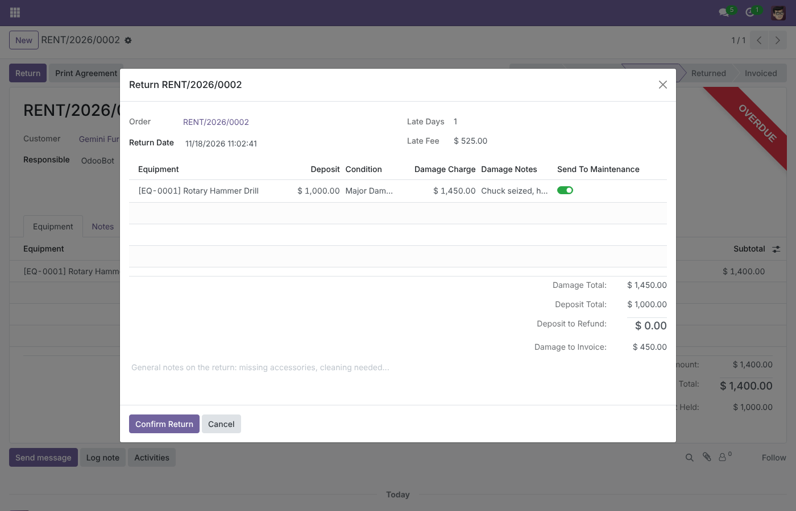
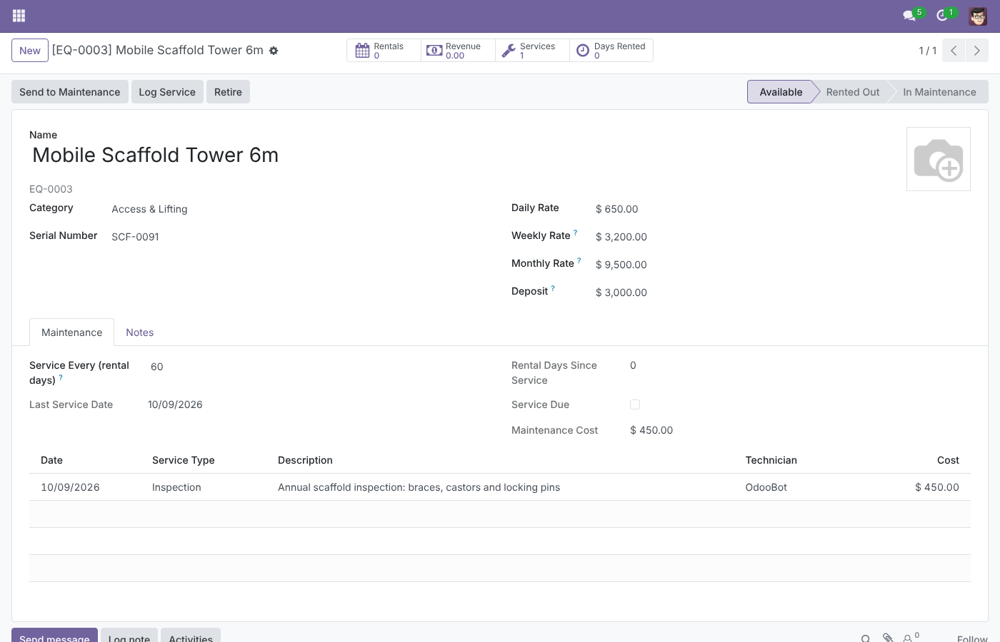

# Odoo Equipment Rental

A custom **Odoo 17** app for businesses that rent out tools, access equipment or event gear. It covers the full rental lifecycle: booking, availability checks, pickup, return, late fees and invoicing.


## Features

| Area | What it does |
|---|---|
| **Equipment catalogue** | Categories, serial numbers, daily / weekly / monthly rates and deposits. Kanban board grouped by status (Available / Rented Out / In Maintenance / Retired). Revenue, rental count, utilisation and maintenance cost per item. |
| **Tiered pricing** | Each line is priced with the cheapest mix of monthly, weekly and daily rates, including rounding a 6-day hire up to a week when that costs less. The breakdown ("1 week + 3 days") shows on the order, invoice and agreement. |
| **Rental orders** | Quotation → Confirmed → Picked Up → Returned → Invoiced workflow, with chatter and field tracking. |
| **Double-booking protection** | A constraint rejects any confirmed rental whose period overlaps another active booking for the same item. Back-to-back bookings are allowed. |
| **Return inspection** | The Return button opens an inspection screen: condition, damage charge and notes per item, with a live preview of late fees, deposit refund and amount to invoice. Damage is taken from the deposit first, and only the excess is invoiced. Damaged items go to maintenance automatically. |
| **Preventive maintenance** | Service interval per item, in rental days. Due items are pulled out of the rental pool when they come back, and a "Service due" activity is scheduled. The service log (preventive, repair, inspection) records cost and technician, resets the counter and returns the item to service. |
| **Late fees** | Charged per late day per item as a configurable % of the daily rate, with a configurable grace period (*Rental → Configuration → Settings*). |
| **Invoicing** | One click creates a customer invoice (`account.move`) with a line per item, plus late fees and damage not covered by the deposit. |
| **Overdue follow-up** | An hourly scheduled action finds overdue rentals and schedules a single to-do for the responsible user. It is closed automatically on return. |
| **Rental agreement** | A QWeb PDF with equipment, pricing breakdown, deposits, totals, the return inspection, the deposit settlement, terms and a signature block. |
| **Reporting** | Calendar, pivot and graph views of rentals over time. |
| **Security** | Rental User / Rental Manager groups and multi-company record rules. |






## Technical overview

```
equipment_rental/
├── models/
│   ├── pricing.py                  # cheapest monthly/weekly/daily combination (pure Python, unit-tested)
│   ├── rental_equipment.py         # rental.equipment, rental.equipment.category, service status
│   ├── rental_equipment_service.py # rental.equipment.service: service log
│   ├── rental_order.py             # rental.order, rental.order.line: workflow, availability, fees, damage, invoicing, cron
│   ├── res_company.py              # late-fee % and grace period per company
│   └── res_config_settings.py
├── wizard/                         # return inspection (rental.return.wizard)
├── views/                          # kanban, list, form, calendar, pivot, graph, search, settings, menus
├── report/                         # QWeb PDF rental agreement
├── security/                       # groups, ACLs, multi-company rules
├── data/                           # sequences (RENT/2026/0001, EQ-0001), scheduled action
├── demo/                           # sample equipment, rentals and service records
└── tests/                          # 35 tests
```

Things worth noting in the code:
- **Overlap detection** uses a single domain search (`start < other.end AND end > other.start`) over active orders, enforced as an `@api.constrains`, so it holds no matter how the record is written.
- **`is_overdue`** is a non-stored computed field with a custom `_search` method, so it can be used in filters, menus and the cron without going stale in the database.
- **Line rates** use `precompute=True` computed fields, so they default from the equipment but stay editable per order.
- **Pricing** is a small dynamic-programming function in `models/pricing.py`, kept free of ORM code so it can be tested in isolation.
- **Deposit settlement** is computed rather than stored as a manual value: `retained = min(damage, deposit)`, `refund = deposit − retained`, `invoiced = damage − retained`. The order, wizard, invoice and PDF always agree.

## Running it

**With Docker**

```bash
docker compose up
```

Open http://localhost:8069, create a database (tick *demo data* to get sample equipment) and install **Equipment Rental** from Apps.

**In an existing Odoo 17 instance**

Add this repository's folder to your `addons_path`, update the apps list and install **Equipment Rental**.

## Tests

```bash
odoo-bin -d test_db -i equipment_rental --test-enable --test-tags=/equipment_rental --stop-after-init
```

There are 35 tests. They cover:
- **Pricing:** cheapest combination, rounding up to a week, overrides on a line, invoice breakdown.
- **Bookings and workflow:** double-booking, back-to-back bookings, cancellation, maintenance blocking, the on-time and late workflows, invoice totals, the overdue cron, invalid transitions.
- **Returns:** the inspection screen end to end, damage settled from the deposit or invoiced above it, maintenance routing.
- **Maintenance:** service intervals, the counter resetting after a service, back-filled service records.
- **Reports:** the PDF renders, including the settlement section.

They run on every push via GitHub Actions.

See [CHANGELOG.md](CHANGELOG.md) for what changed in each version.

## License

LGPL-3
