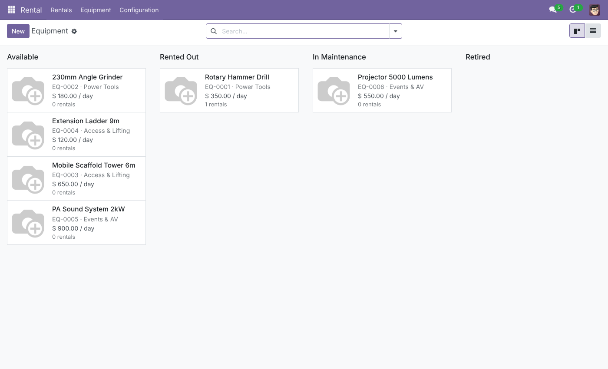
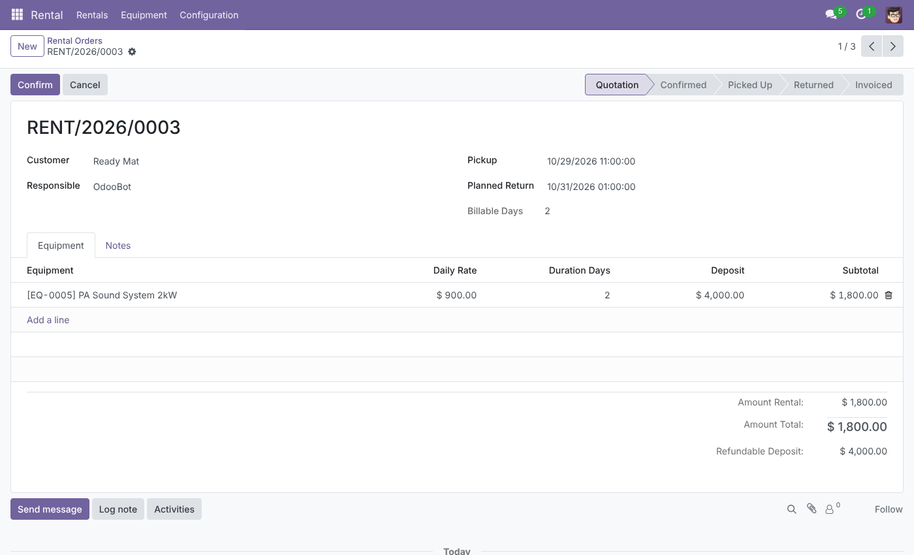

# Odoo Equipment Rental

A custom **Odoo 17** app for businesses that rent out tools, access equipment or event gear. It covers the full rental lifecycle: booking, availability checks, pickup, return, late fees and invoicing.



## Features

| Area | What it does |
|---|---|
| **Equipment catalogue** | Categories, serial numbers, daily rates and deposits. Kanban board grouped by status (Available / Rented Out / In Maintenance / Retired). Per-item revenue, rental count and utilisation days. |
| **Rental orders** | Quotation → Confirmed → Picked Up → Returned → Invoiced workflow, with chatter and field tracking. Billable days round partial days up. |
| **Double-booking protection** | A constraint rejects any confirmed rental whose period overlaps another active booking for the same item. Back-to-back bookings are allowed. |
| **Late fees** | Charged per late day per item as a configurable % of the daily rate, with a configurable grace period (*Rental → Configuration → Settings*). |
| **Invoicing** | One click creates a customer invoice (`account.move`) with a line per item, plus the late fee. |
| **Overdue follow-up** | An hourly scheduled action finds overdue rentals and schedules a single to-do for the responsible user. It is closed automatically on return. |
| **Rental agreement** | A QWeb PDF report with equipment, deposits, totals, terms and a signature block. |
| **Reporting** | Calendar, pivot and graph views of rentals over time. |
| **Security** | Rental User / Rental Manager groups and multi-company record rules. |



## Technical overview

```
equipment_rental/
├── models/
│   ├── rental_equipment.py    # rental.equipment, rental.equipment.category
│   ├── rental_order.py        # rental.order, rental.order.line: workflow, availability, fees, invoicing, cron
│   ├── res_company.py         # late-fee % and grace period per company
│   └── res_config_settings.py
├── views/                     # kanban, list, form, calendar, pivot, graph, search, settings, menus
├── report/                    # QWeb PDF rental agreement
├── security/                  # groups, ACLs, multi-company rules
├── data/                      # sequences (RENT/2026/0001, EQ-0001), scheduled action
├── demo/                      # sample equipment and rentals
└── tests/                     # 12 TransactionCase tests
```

Things worth noting in the code:
- **Overlap detection** uses a single domain search (`start < other.end AND end > other.start`) over active orders, enforced as an `@api.constrains`, so it holds no matter how the record is written.
- **`is_overdue`** is a non-stored computed field with a custom `_search` method, so it can be used in filters, menus and the cron without going stale in the database.
- **Line rates** use `precompute=True` computed fields, so they default from the equipment but stay editable per order.

## Running it

**With Docker**

```bash
docker compose up
```

Open http://localhost:8069, create a database (tick *demo data* to get sample equipment) and install **Equipment Rental** from Apps.

**In an existing Odoo 17 instance**

Add this repository's folder to your `addons_path`, update the apps list and install **Equipment Rental**.

## Tests

```bash
odoo-bin -d test_db -i equipment_rental --test-enable --test-tags=/equipment_rental --stop-after-init
```

The tests cover sequencing, amounts, partial-day rounding, double-booking, back-to-back bookings, cancellation, maintenance blocking, the on-time and late workflows, invoice totals, the overdue cron, invalid transitions and report rendering. They also run on every push via GitHub Actions.

## License

LGPL-3
